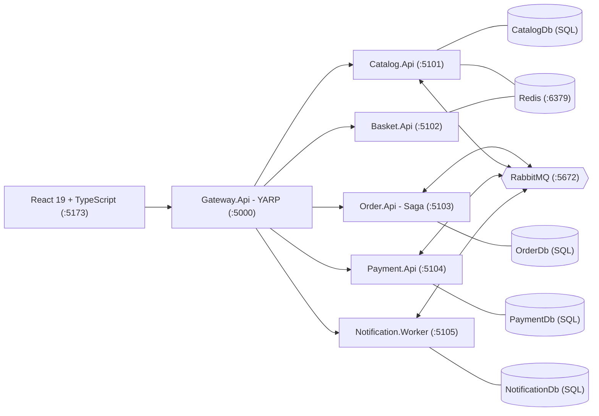

# Mini Mağaza — .NET 10 Mikroservis & Ödeme Sistemleri Projesi

İlandaki tüm teknik yetkinlikleri ve artı kriterleri (**C# / .NET 10, Mikroservis Mimarisi, YARP API Gateway, Dağıtık Hata Yönetimi, Saga, Transactional Outbox / Inbox, Polly, OpenTelemetry, RabbitMQ, Redis, MS SQL Server T-SQL İndeksleme & Sorgu Optimizasyonu, ISO 8583 / 3D Secure / EMV TLV**) tek bir çalışan uygulamada gösteren Türkçe e-ticaret ve ödeme sistemi.

---

## 1. Mimari ve Servisler



| Proje | Port | Sorumluluk ve Gösterdiği Yetkinlikler |
|---|---|---|
| `Gateway.Api` | `5000` | **YARP Reverse Proxy**, Rate Limiting (`FixedWindow`), `X-Correlation-Id` üretimi/aktarımı, birleştirilmiş `/api/health` kontrolü |
| `Catalog.Api` | `5101` | Ürün kataloğu, **Decorator kalıbı ile Redis Cache-Aside** (`CachedProductCatalogReader`), Filtered & Covering SQL indeksi, stok rezervasyonu ve **Saga telafisi (`ReleaseStock`)** |
| `Basket.Api` | `5102` | Müşteri sepeti (**Redis** üzerinde 24 saat kayan TTL + bellek içi fallback) |
| `Order.Api` | `5103` | **Saga Orkestratörü** (`Pending → StockReserved → Confirmed / Cancelled`), **Polly (`StandardResilienceHandler`)** ile dayanıklı HTTP çağrısı, `SagaTimeoutWorker`, **Dapper + T-SQL Stored Procedure (`sp_GunlukSatisRaporu`)** |
| `Payment.Api` | `5104` | **Luhn** algoritması, **BIN** şema tespiti (Visa/Mastercard/Troy), **PCI DSS PAN maskeleme**, **3D Secure 2.2 OTP** doğrulaması, **ISO 8583 (`0100`/`0110`/`0400`)** mesaj paketleyici/çözücü, **EMV BER-TLV** ayrıştırıcı, `Idempotency-Key` koruması |
| `Notification.Worker` | `5105` | `OrderConfirmed` ve `OrderCancelled` olaylarını **Inbox (idempotent)** deseniyle tüketir |
| `Identity.Api` | `5106` | **Üye Veritabanı (`ETicaret_IdentityDb -> dbo.Users`)**, PBKDF2-SHA256 yerel giriş/kayıt, **Google OAuth 2.0 / OIDC (`id_token`) doğrulaması**, JWT üretimi ve **Admin (`AdminOnly`)** rol yetkilendirmesi |

---

## 2. Dağıtık Hata Yönetimi ve Tasarım Kalıpları

* **Transactional Outbox (`OutboxMessage` + `OutboxPublisher`)**: Veritabanı değişikliği ve entegrasyon olayı aynı SQL transaction içinde kaydedilir; RabbitMQ **Publisher Confirms** ile yayınlanır.
* **Idempotent Consumer / Inbox (`InboxMessage` + `InboxProcessor`)**: Aynı `MessageId` birden fazla kez gelse bile yalnızca bir kez işlenir.
* **Retry + Dead-Letter Queue (DLQ)**: İşlenemeyen mesajlar TTL'li `<kuyruk>.retry` kuyruğunda bekletilip tekrar denenir; maksimum deneme (`MaxRetries = 3`) aşılınca `<kuyruk>.dlq` kuyruğuna taşınır.
* **Saga Orkestrasyonu ve Telafi (Compensation)**:
  * Ödeme reddedildiğinde (`51 Yetersiz Bakiye`, `05 Banka Reddi`, `91 Switch Hatası`) veya 3D Secure 3 kez yanlış girildiğinde `Order.Api` otomatik olarak `ReleaseStock` komutu yayınlar ve `Catalog.Api` ayrılan stoğu geri yükler.
  * Zaman aşımına uğrayıp iptal edilmiş bir siparişe sonradan ödeme onayı gelirse `RefundPayment` komutu ile **ISO 8583 `0400` Reversal** mesajı üretilir.
* **Polly Dayanıklılık Politikaları**: `Order.Api` → `Catalog.Api` HTTP çağrılarında üstel geri çekilmeli retry, circuit breaker ve timeout uygulanır. Arayüzdeki **Yönetim → Kaos Mühendisliği** ekranından canlı test edilebilir.
* **Gözlemlenebilirlik**: **OpenTelemetry** (`ActivitySource` + W3C `traceparent` başlığının RabbitMQ mesajları üzerinden taşınması) ve **RFC 7807 ProblemDetails** (`GlobalProblemExceptionHandler`).

---

## 3. MS SQL Server ve T-SQL Yetkinlikleri

SQL scriptleri ve analiz notları [`docs/sql/`](docs/sql/) ve [`docs/sql-optimizasyon.md`](docs/sql-optimizasyon.md) altındadır:
* [`docs/sql/01_indeksler.sql`](docs/sql/01_indeksler.sql): `IX_Orders_CustomerId_CreatedAt_Covering` (Key Lookup eliminasyonu), `IX_OutboxMessages_Unprocessed` (Filtered Index), `IX_Products_Active_Category_Name`.
* [`docs/sql/02_rapor_sp.sql`](docs/sql/02_rapor_sp.sql): CTE + Window Functions (`SUM() OVER`, `DENSE_RANK() OVER`) kullanan `dbo.sp_GunlukSatisRaporu`.
* [`docs/sql/03_optimizasyon_ornekleri.sql`](docs/sql/03_optimizasyon_ornekleri.sql): 10.000 satırlık veri üzerinde Non-SARGable vs. SARGable sorgu, Covering Index ve `OPTION (RECOMPILE)` karşılaştırması (`SET STATISTICS IO, TIME ON`).

---

## 4. Çalıştırma

```powershell
# Tüm altyapıyı (LocalDB, RabbitMQ, Redis), servisleri ve React arayüzünü başlatır:
.\baslat.ps1

# Birim testlerini çalıştırmak için:
dotnet test --solution ETicaret.slnx
```

* **React Arayüzü**: `http://localhost:5173`
* **API Gateway Sağlık Kontrolü**: `http://localhost:5000/api/health`
* **RabbitMQ Management UI**: `http://localhost:15672` (`guest` / `guest`)

---

## 5. Üye Veritabanı (`ETicaret_IdentityDb`) ve Hazır Giriş Hesapları

Üyeler **SQL Server** üzerinde **`ETicaret_IdentityDb`** veritabanındaki **`dbo.Users`** tablosunda tutulur. İlk açılışta aşağıdaki hesaplar otomatik oluşturulur (ayrıca `/giris` ekranından **Google ile Giriş** veya **Yeni Üye Kaydı** yapılabilir):

| E-posta | Şifre | Rol | Yetki Kapsamı |
|---|---|---|---|
| `admin@minimagaza.com` | `Admin123!` | `Admin` | Ürün ekleme/düzenleme/silme, Kaos simülasyonu, Üye listeleme ve Admin/Customer rol atama |
| `musteri@minimagaza.com` | `Musteri123!` | `Customer` | Alışveriş, sepet, 3D Secure ödeme, sipariş ve bildirim takibi |

---

## 6. Test Kartları ve Senaryolar

| Kart Numarası | Marka | 3D Secure | Beklenen Sonuç |
|---|---|---|---|
| `4543 6000 0000 0003` | Visa | Evet (SMS: `123456`) | `00` — Onaylandı (`Confirmed`) |
| `5528 7900 0000 0008` | Mastercard | Evet (SMS: `123456`) | `00` — Onaylandı (`Confirmed`) |
| `4111 1111 1111 1111` | Visa | Hayır | `00` — Doğrudan Onaylandı (`Confirmed`) |
| `5406 6700 0000 0009` | Mastercard | Evet (SMS: `123456`) | `51` — Yetersiz Bakiye → **Saga Telafisi (Stok İadesi)** |
| `9792 0000 0000 0003` | Troy | Hayır | `05` — Banka Reddi → **Saga Telafisi (Stok İadesi)** |

