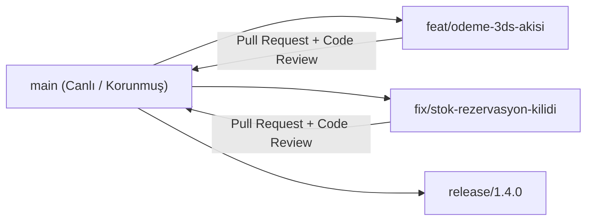

# Git Kullanımı ve Branching Stratejisi

Canlı ortamda çalışan mikroservis ekiplerinde kullanılan dallanma (branching) ve commit standartları.

## 1. Branch Yapısı (Trunk-Based / GitHub Flow + Release Branches)

* **`main`**: Her zaman derlenebilir ve tüm birim/entegrasyon testlerinden geçmiş kararlı daldır. Doğrudan push kapalıdır.
* **`feat/<konu>`**: Yeni özellik dalları (ör. `feat/iso8583-reversal`, `feat/catalog-redis-cache`). Kısa ömürlüdür (1–3 gün).
* **`fix/<konu>`**: Hata düzeltme dalları (ör. `fix/outbox-retry-limit`).
* **`hotfix/<konu>`**: Canlı ortamda acil müdahale gerektiren durumlar için `main`'den açılır, PR sonrası etiketlenerek (`v1.4.1`) birleştirilir.

## 2. Conventional Commits Standardı

Commit mesajları Türkçe ve anlamlı bir önek ile yazılır:

* `feat(payment): ISO 8583 0100/0110 mesaj paketleyici ve 3D Secure akışı eklendi`
* `feat(order): sipariş Saga orkestratörü ve stok telafi adımı eklendi`
* `perf(sql): Orders ve OutboxMessages tablolarına covering/filtered indeks eklendi`
* `fix(messaging): Inbox tablosu ile mükerrer mesaj tüketimi engellendi`
* `test(payment): Luhn, BIN, ISO 8583 ve EMV BER-TLV birim testleri eklendi`

## 3. Mikroservislerde Geriye Dönük Uyumluluk (Backward Compatibility)

Servisler bağımsız dağıtıldığı için:
1. `BuildingBlocks.Contracts` içindeki mesajlara yeni alan ekleneceğinde **nullable / varsayılan değerli** eklenir (mevcut tüketiciler kırılmaz).
2. Veritabanı şema değişiklikleri **Expand → Migrate → Contract** (önce sütunu nullable ekle, kodu güncelle, en son eski sütunu kaldır) sırasıyla uygulanır.

